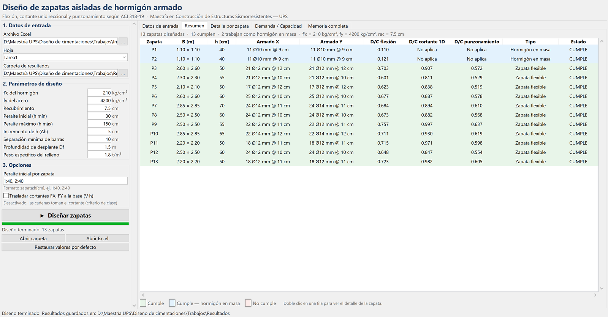
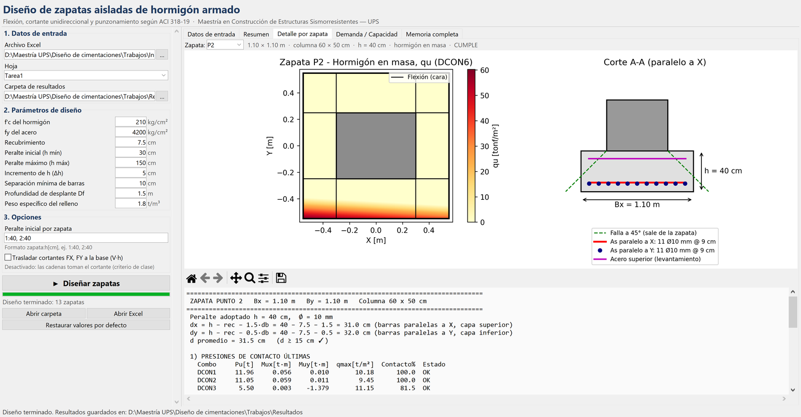
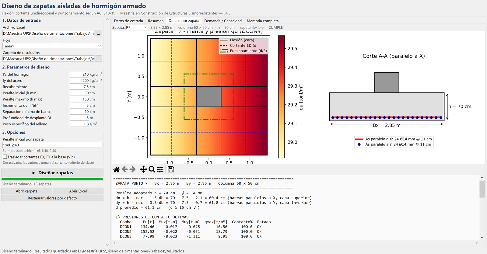

# Diseño de zapatas aisladas de hormigón armado — ACI 318-19

Procedimiento computacional reproducible, escrito en Python, para el diseño estructural de
zapatas aisladas de hormigón armado. Verifica **flexión**, **cortante unidireccional** y
**cortante bidireccional (punzonamiento)** según el ACI 318-19 y los criterios desarrollados en
clase. Puede usarse con una **interfaz gráfica de escritorio**, como **aplicación web**
(Streamlit) o desde la consola.

> Maestría en Construcción de Estructuras Sismorresistentes — Universidad Politécnica Salesiana  
> Asignatura: Diseño de Cimentaciones



---

## Contenido

- [Características](#características)
- [Estructura del repositorio](#estructura-del-repositorio)
- [Instalación](#instalación)
- [Uso](#uso)
- [Versión web (Streamlit)](#versión-web-streamlit)
- [Datos de entrada](#datos-de-entrada)
- [Parámetros de diseño](#parámetros-de-diseño)
- [Resultados que genera](#resultados-que-genera)
- [Metodología](#metodología)
- [Resultados del proyecto](#resultados-del-proyecto)
- [Validación](#validación)
- [Hipótesis y limitaciones](#hipótesis-y-limitaciones)

---

## Características

- Lee las reacciones de ETABS desde Excel (13 zapatas × 6 combinaciones mayoradas) y **valida los
  datos**: columnas faltantes, unidades inconsistentes, celdas vacías o con texto, geometría
  imposible, combinaciones repetidas. Corre con cualquier otro archivo con la misma estructura sin
  cambiar el código.
- Calcula la presión de contacto **sin admitir tracciones en el suelo**, incluso con contacto
  parcial biaxial, e incluye el **peso propio de la zapata y el relleno** recalculado con cada `h`.
- **Señala cada combinación con pérdida de contacto** (estado REVISAR) y las que quedan fuera del
  modelo, como resultante fuera de la zapata o tracción (estado NO CUMPLE).
- Busca automáticamente el peralte `h` y el diámetro de barra que cumplen todas las verificaciones,
  y registra la combinación crítica y **la verificación que controla el peralte**.
- Admite columnas excéntricas (columnas opcionales `ecx`, `ecy`).
- Detecta cuándo la sección de cortante queda fuera del voladizo (`d ≥ voladizo`): la zapata
  trabaja como **hormigón en masa** y no se verifica el cortante.
- Revisa además el anclaje del refuerzo, el aplastamiento columna-zapata, el acero superior por
  pérdida de contacto y la distribución del acero en zapatas rectangulares.
- Genera una memoria de cálculo paso a paso, un Excel de resultados y las figuras de cada zapata.
- Incluye una interfaz gráfica de escritorio (Tkinter) y una versión web (Streamlit). Ambas
  validan los datos y permiten revisar cada zapata.

## Estructura del repositorio

```
├── Diseno_Zapatas_Aisladas.py         # Motor de cálculo (también se ejecuta solo, por consola)
├── Interfaz_Zapatas.py                # Interfaz gráfica de escritorio (Tkinter)
├── Ejecutar_Interfaz.bat              # Acceso directo para abrir la interfaz en Windows
├── app.py                             # Versión web (Streamlit)
├── .streamlit/config.toml             # Tema y límite de tamaño de archivos de la versión web
├── InputData01.xlsx                   # Datos de entrada (hoja "Tarea1")
├── Explicacion_Programa_Zapatas.docx  # Documento que explica el programa paso a paso
├── requirements.txt                   # Dependencias (pip)
├── entorno-conda.yml                  # Entorno conda (uso local)
├── docs/img/                          # Capturas usadas en este README
└── Resultados/                        # Salidas generadas por el programa
```

## Instalación

Se necesita **Python 3.10** (probado con 3.10.22) y las librerías `numpy`, `pandas`, `matplotlib`
y `openpyxl`. La interfaz de escritorio usa `tkinter`, que viene incluido con Python. La versión
web necesita además `streamlit` (probado con 1.65). Las dos opciones siguientes instalan todo.

**Opción A — conda (recomendada, igual que en el curso):**

```bash
git clone https://github.com/carodaysi/disenio-zapatas.git
cd disenio-zapatas
conda env create -f entorno-conda.yml
conda activate zapatas
```

**Opción B — pip:**

```bash
git clone https://github.com/carodaysi/disenio-zapatas.git
cd disenio-zapatas
pip install -r requirements.txt
```

Si ya tienes el entorno del curso (`spyder-env`), solo falta `openpyxl`, que pandas necesita para
leer archivos `.xlsx`:

```bash
conda activate spyder-env
pip install openpyxl
```

## Uso

### Interfaz gráfica

```bash
python Interfaz_Zapatas.py
```

En Windows también se abre con doble clic en `Ejecutar_Interfaz.bat`. Ese archivo apunta a
`D:\Programas_inst\miniconda\envs\spyder-env\pythonw.exe`; en otra computadora hay que cambiar
esa ruta por la del `pythonw.exe` de su entorno.

1. **Datos de entrada:** elige el Excel, la hoja y la carpeta de resultados.
2. **Parámetros de diseño:** revisa f'c, fy, recubrimiento, peraltes, separación de barras, etc.
3. **Opciones:** peralte inicial por zapata (opcional, por ejemplo `1:45, 2:45`), peso propio de
   zapata y relleno, y traslado del cortante.
4. Presiona **Diseñar zapatas**. Los resultados aparecen en las pestañas *Resumen*, *Detalle por
   zapata*, *Demanda / Capacidad* y *Memoria completa*. Doble clic en una fila del resumen abre
   el detalle de esa zapata.



### Consola o Spyder

```bash
python Diseno_Zapatas_Aisladas.py
```

En Spyder: abre `Diseno_Zapatas_Aisladas.py` y presiona **F5**. Los parámetros se cambian en la
**sección 0** del archivo. El programa imprime la memoria de cálculo y guarda los resultados en
`Resultados/`.

> Si `Resultados_Zapatas.xlsx` está abierto en Excel, ciérralo antes de ejecutar; de lo contrario
> no se puede sobrescribir.

## Versión web (Streamlit)

`app.py` ofrece las mismas funciones que la interfaz de escritorio, pero en el navegador. Usa el
mismo motor de cálculo, así que los resultados son idénticos.

- **Datos:** se sube el Excel desde la computadora del usuario. Si no se sube ninguno, se usan los
  datos de ejemplo (`InputData01.xlsx`), que también se pueden descargar como plantilla.
- **Parámetros y opciones:** en la barra lateral, con la misma validación que la versión de
  escritorio.
- **Resultados:** pestañas *Datos de entrada*, *Resumen*, *Detalle por zapata*,
  *Demanda / Capacidad* y *Memoria completa*.
- **Descargas:** Excel de resultados, memoria de cálculo y un `.zip` con todo, incluidas las
  figuras. En la web los archivos no se guardan en el servidor.
- Si se cambian los datos o los parámetros después de diseñar, la página avisa que los
  resultados mostrados son del diseño anterior.

### Ejecutar en la computadora

```bash
streamlit run app.py
```

Se abre en el navegador en `http://localhost:8501`. Funciona sin internet.

### Publicar en Streamlit Community Cloud (gratis)

1. Entra a <https://share.streamlit.io> e inicia sesión con la cuenta de GitHub.
2. Elige **Create app → Deploy a public app from GitHub**.
3. Selecciona el repositorio `carodaysi/disenio-zapatas`, la rama `main` y el archivo `app.py`.
4. En **Advanced settings** elige Python 3.10 (o superior) y presiona **Deploy**.

Streamlit Cloud instala las dependencias de `requirements.txt` y publica la app en una dirección
`https://….streamlit.app`. Cada `git push` a `main` la actualiza automáticamente. Si nadie la usa
durante varios días se suspende, y el primer acceso tarda unos segundos en reactivarla.

## Datos de entrada

Hoja `Tarea1` de `InputData01.xlsx`: una fila por zapata y combinación.

| Columna | Significado | Unidad |
|---|---|---|
| `Story` | Nivel (BASE) | — |
| `Point` | Número de la zapata / columna | — |
| `Load` | Combinación mayorada (DCON1 … DCON6) | — |
| `FX`, `FY` | Cortantes en la base de la columna (opcionales) | tonf |
| `FZ` | Carga axial (positiva = compresión) | tonf |
| `MX`, `MY` | Momentos alrededor de X e Y | tonf·m |
| `MZ` | Torsión (no interviene en el diseño) | tonf·m |
| `Bx[m]`, `By[m]` | Dimensiones en planta de la zapata | m |
| `Bcx[m]`, `Bcy[m]` | Dimensiones de la columna | m |
| `ecx[m]`, `ecy[m]` | Excentricidad de la columna respecto al centro de la zapata (opcionales, 0 si no están) | m |

Obligatorias: `Point`, `Load`, `FZ`, `MX`, `MY`, `Bx`, `By`, `Bcx`, `Bcy`. Los encabezados pueden
llevar la unidad entre corchetes (`Bx[m]`); si la unidad no es la esperada, por ejemplo `Bx[cm]`,
el programa se detiene con un mensaje. Las demás columnas (`Story`, `MZ`) se ignoran.

**Convención de signos** (origen en el centro de la zapata): `MY > 0` lleva la resultante hacia
+X (`ex = MY/P`) y `MX > 0` hacia +Y (`ey = MX/P`). Con la columna centrada la zapata se revisa a
ambos lados, así que el signo solo define qué borde se carga. Con columna excéntrica, `ecx` y
`ecy` deben estar en el mismo sistema, porque el momento `P·e` se suma a `MY` y `MX`.

Las dimensiones en planta vienen del dimensionamiento previo por presión admisible y **no se
modifican**. Este programa hace el diseño **por resistencia** con cargas mayoradas.

## Parámetros de diseño

Están al inicio de `Diseno_Zapatas_Aisladas.py` (sección 0) y se pueden editar en la interfaz.

| Parámetro | Variable | Valor | Referencia |
|---|---|---|---|
| Resistencia del hormigón f'c | `FC` | 210 kg/cm² | — |
| Fluencia del acero fy | `FY` | 4200 kg/cm² | — |
| Recubrimiento (contra el suelo) | `REC` | 7.5 cm | ACI 20.5.1.3.1 |
| φ flexión / cortante / aplastamiento | `PHI_*` | 0.90 / 0.75 / 0.65 | ACI 21.2.1 |
| Factor de tamaño λs | `LAMBDA_S` | 1.0 | ACI 13.2.6.2 |
| αs (columna interior) | `ALPHA_S` | 40 | ACI 22.6.5.3 |
| Cuantía mínima | `RHO_MIN` | 0.0018 | ACI 8.6.1.1 |
| Peralte efectivo mínimo | `D_MIN` | 15 cm | ACI 13.3.1.2 |
| Peralte inicial / máximo / incremento | `H_MIN` / `H_MAX` / `DH` | 40 / 150 / 5 cm | Espesor mínimo práctico |
| Peralte inicial por zapata (opcional) | `H_MIN_PUNTO` | vacío | — |
| Sumar peso propio de zapata y relleno | `INCLUIR_PESO_PROPIO` | `True` | Las reacciones de ETABS no lo incluyen |
| Factor de carga del peso propio | `FACTOR_PESO` | 0.9 | 0.9D + E, conservador para el contacto |
| γ hormigón / γ relleno / Df | `GAMMA_C` / `GAMMA_S` / `DF` | 2.4 / 1.8 t/m³ / 1.50 m | — |
| Separación mínima entre barras | `S_MIN` | 10 cm | Constructibilidad |
| Espaciamiento libre mínimo | `S_LIBRE_MIN` | 2.5 cm | ACI 25.2.1 |
| Diámetros, en orden de preferencia | `DIAMETROS` | 12 … 25 mm, 10 mm al final | — |
| Traslado del cortante a la base (V·h) | `TRASLADAR_CORTANTE` | `False` | Las cadenas toman el cortante |

Unidades internas: fuerzas en tonf, longitudes en m y presiones en tonf/m². Las resistencias usan
las expresiones mks del ACI 318-19 (1 kg/cm² = 10 tonf/m²).

## Resultados que genera

En la carpeta `Resultados/`:

| Archivo | Contenido |
|---|---|
| `Resultados_Zapatas.xlsx` | *Resumen*: una fila por zapata con dimensiones, f'c, fy, h, dx, dy; As requerido, mínimo y provisto en X e Y; barras y separación; Vu, φVc y D/C de cortante 1D y punzonamiento; combinación controlante de cada verificación; verificación que gobierna y la que controla h; advertencias y estado. *Detalle_Combos*: solicitaciones, estado de contacto y D/C de cada combinación, incluidas las que quedan fuera del modelo. *Datos_Entrada*: tabla validada. *Parametros* |
| `Memoria_Calculo.txt` | Memoria de cálculo paso a paso de cada zapata |
| `Zapata_P1.png` … `Zapata_P13.png` | Planta con presiones y secciones críticas, y corte con el armado |
| `Resumen_Demanda_Capacidad.png` | Relación demanda/capacidad de todas las verificaciones |

## Metodología

Para cada zapata y cada combinación:

1. **Presión de contacto.** Se supone una zapata rígida:
   `qu = P/A + My·x/Iyy + Mx·y/Ixx`, con `P = FZ + W`, donde `W = 0.9·(γc·h + γs·(Df − h))·Bx·By`
   es el peso de la zapata y el relleno. Si aparecen tracciones, se resuelve el contacto parcial
   por Newton-Raphson sobre una malla de 200 × 200 celdas, con `q = máx(plano, 0)` y las tres
   ecuaciones de equilibrio (ΣF, ΣMx, ΣMy).
   - Combinación con contacto parcial: se diseña con esa distribución, pero se señala y la zapata
     queda en **REVISAR**.
   - Combinación con `P ≤ 0` o resultante fuera de la zapata: queda fuera del modelo y la zapata
     **NO CUMPLE**.
   - El peso `w = W/(Bx·By)` también carga los voladizos hacia abajo, así que la flexión y el
     cortante se calculan con la **presión neta `qu − w`**. Así no se cuenta dos veces: con
     contacto total, W no cambia las solicitaciones.
2. **Peralte y peralte efectivo.** Se prueba `h` desde 40 cm en pasos de 5 cm. La dirección con
   mayor momento va en la capa inferior:
   `d = h − rec − db/2` (capa inferior) y `d = h − rec − 1.5·db` (capa superior, el caso más
   desfavorable). Cada dirección se revisa con su propio `d`.
3. **Hormigón en masa.** Si `d ≥ (B − c)/2` en una dirección, la sección crítica de cortante queda
   fuera de la zapata y no hay cortante en esa dirección. Si ocurre en ambas, tampoco hay
   punzonamiento.
4. **Flexión** en la cara de la columna (ACI 13.2.7.1): `Mu = ∫ qu·(x − c/2) dA`,
   `As = máx(As,req; 0.0018·b·h)`, con separación ≤ mín(2h; 45 cm) (ACI 8.7.2.2) y control de εt.
5. **Cortante unidireccional** a `d` de la cara (ACI 8.4.3.2), sin estribos (ACI 22.5.5.1c):
   `vc = 2.12·λs·λ·ρw^(1/3)·√f'c ≤ 1.33·λ·√f'c`, con `φVc ≥ Vu`.
6. **Punzonamiento** en el perímetro a `d/2` (ACI 22.6.4) con transferencia de momento
   (ACI 8.4.4.2):
   `vu = Vu/(bo·d) + γv·Msc·c/Jc ≤ φ·mín{1.06; 0.53(1 + 2/β); 0.27(2 + αs·d/bo)}·√f'c`.
7. **Verificaciones complementarias:** anclaje con barra recta o gancho de 90° (ACI 25.4),
   aplastamiento (ACI 22.8), zapatas rectangulares (ACI 13.3.3.3) y acero superior por pérdida
   de contacto (ACI 18.13.2.5).
8. Si alguna verificación no cumple, se aumenta `h`, se recalculan las presiones con el nuevo
   peso propio y se repite. Se registra la verificación que falló con el `h` anterior, que es la
   que **controla el peralte**. Si no hay solución hasta `H_MAX`, se informa expresamente.

La explicación detallada, con fórmulas, diagrama de flujo y referencias, está en
[`Explicacion_Programa_Zapatas.docx`](Explicacion_Programa_Zapatas.docx).

## Resultados del proyecto

Las 13 zapatas resisten. P3 a P13 **cumplen**. P1 y P2 quedan en **REVISAR** porque pierden
contacto parcial con el suelo: P1 en DCON5, con 99.0 % del área en contacto, y P2 en DCON6, con
76.6 %. Columna de 60 × 50 cm, f'c = 210 kg/cm², fy = 4200 kg/cm².

| Zapata | B [m] | h [cm] | Armado (X e Y) | D/C flexión | D/C cortante 1D | D/C punzonamiento | Tipo |
|---|---|---|---|---|---|---|---|
| P1 | 1.10 | 40 | 11 Ø10 mm @ 9 cm | 0.110 | No aplica | No aplica | Hormigón en masa (REVISAR) |
| P2 | 1.10 | 40 | 11 Ø10 mm @ 9 cm | 0.121 | No aplica | No aplica | Hormigón en masa (REVISAR) |
| P3 | 2.60 | 50 | 21 Ø12 mm @ 12 cm | 0.703 | 0.907 | 0.572 | Flexible |
| P4 | 2.30 | 55 | 21 Ø12 mm @ 10 cm | 0.601 | 0.811 | 0.529 | Flexible |
| P5 | 2.10 | 50 | 17 Ø12 mm @ 12 cm | 0.623 | 0.838 | 0.519 | Flexible |
| P6 | 2.60 | 60 | 25 Ø12 mm @ 10 cm | 0.677 | 0.887 | 0.578 | Flexible |
| P7 | 2.85 | 70 | 24 Ø14 mm @ 11 cm | 0.684 | 0.894 | 0.610 | Flexible |
| P8 | 2.50 | 60 | 24 Ø12 mm @ 10 cm | 0.673 | 0.882 | 0.568 | Flexible |
| P9 | 2.50 | 55 | 22 Ø12 mm @ 11 cm | 0.757 | 0.997 | 0.637 | Flexible |
| P10 | 2.85 | 65 | 22 Ø14 mm @ 12 cm | 0.711 | 0.930 | 0.619 | Flexible |
| P11 | 2.20 | 50 | 18 Ø12 mm @ 11 cm | 0.715 | 0.971 | 0.598 | Flexible |
| P12 | 2.50 | 60 | 24 Ø12 mm @ 10 cm | 0.648 | 0.847 | 0.554 | Flexible |
| P13 | 2.20 | 50 | 18 Ø12 mm @ 11 cm | 0.723 | 0.982 | 0.605 | Flexible |

Observaciones:

- El **cortante unidireccional controla el peralte**: con cuantías bajas (ρw ≈ 0.002),
  `vc ≈ 3.9 kg/cm²`, casi la mitad de `0.53·√f'c`.
- En todas las zapatas el acero de flexión lo define la **cuantía mínima** 0.0018·b·h.
- **P1 y P2** tienen voladizos de 25 y 30 cm. Con h = 40 cm, que es el peralte inicial de
  búsqueda, `d ≥ voladizo` y trabajan como hormigón en masa. Usan barras Ø10 con gancho de 90°
  para anclarse y llevan acero superior porque pierden contacto parcial en las combinaciones
  sísmicas.
- La pérdida de contacto de P1 y P2 no se corrige aumentando `h`, porque Bx y By son datos. Hay que
  revisarla en el dimensionamiento geotécnico: estabilidad y presión admisible con cargas de
  servicio, o vigas de amarre.

## Validación

Se verificó a mano la zapata P7 (2.85 × 2.85 m, combinación DCON4, Pu = 237.52 t):

| Cálculo | A mano | Programa |
|---|---|---|
| qu,máx neta (sin peso propio) | 29.57 t/m² | 29.57 t/m² |
| Mu,x en la cara | 53.16 t·m | 53.17 t·m |
| As,req,x | 23.70 cm² | 23.67 cm² |
| φVc,y (cortante 1D) | 51.9 t | 51.95 t |
| Vu de punzonamiento | 198.18 t | 198.18 t |
| vc de punzonamiento | 15.36 kg/cm² | 15.36 kg/cm² |



## Hipótesis y limitaciones

- Zapata rígida, con distribución lineal de presiones y sin tracciones en el suelo.
- Se admite una columna excéntrica mientras el perímetro de punzonamiento quede completo dentro
  de la zapata (modelo de columna interior, αs = 40). Si un borde lo corta, la zapata se marca
  NO CUMPLE y hay que tratarla como medianera o esquinera, cambiando αs a 30 o 20 y la geometría
  del perímetro crítico.
- Los cortantes FX y FY los toman las cadenas (`TRASLADAR_CORTANTE = False`). Con `True` se
  trasladan a la base como un momento adicional V·h.
- La presión admisible del suelo y los asentamientos se verifican en el dimensionamiento con
  cargas de servicio, que queda fuera de este programa.
- Se supone que el hormigón de la columna tiene el mismo f'c que la zapata.
